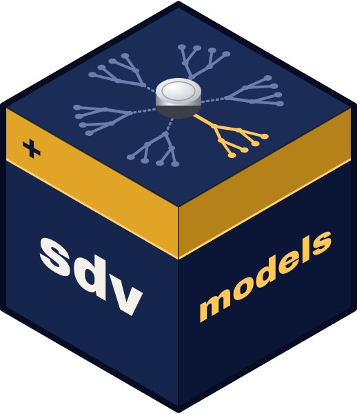

<!-- README.md is generated from README.Rmd. Please edit that file -->

```{r, include = FALSE}
knitr::opts_chunk$set(
  collapse = TRUE,
  comment = "#>",
  fig.path = "man/figures/README-",
  out.width = "100%"
)
```

# sdvmodels <a href='https://sdvmodels.sportsdataverse.org'></a>

<!-- badges: start -->
[](https://CRAN.R-project.org/package=sdvmodels)
[](https://github.com/sportsdataverse/sdvmodels/)
[](https://github.com/sportsdataverse/sdvmodels/actions/workflows/R-CMD-check.yaml)
[](https://lifecycle.r-lib.org/articles/stages.html#experimental)
[](https://github.com/sportsdataverse/sdvmodels/blob/main/LICENSE.md)
[](https://x.com/saiemgilani)
[](https://x.com/SportsDataverse)
[](https://github.com/sportsdataverse/sdvmodels/graphs/contributors)
<!-- badges: end -->

A data package that hosts the fitted models used by
[cfbfastR](https://cfbfastR.sportsdataverse.org/) and the wider
SportsDataverse ecosystem, in the way
[fastrmodels](https://github.com/nflverse/fastrmodels) hosts the models of
nflfastR. The models are the `cfb_model_artifacts` release of
[sportsdataverse-data](https://github.com/sportsdataverse/sportsdataverse-data),
the single bundle that both cfbfastR and
[sportsdataverse-py](https://py.sportsdataverse.org/) score with, re-packaged
byte for byte.

Data freshness and pipeline status for every SportsDataverse dataset: [sportsdataverse.org/status](https://sportsdataverse.org/status).

## **Installation**

You can install the released version of sdvmodels from
[CRAN](https://CRAN.R-project.org/package=sdvmodels) with:

``` r
install.packages("sdvmodels")
```

And the development version from [GitHub](https://github.com/sportsdataverse/sdvmodels) with:

``` r
# install.packages("pak")
pak::pak("sportsdataverse/sdvmodels")
```

## **What is in it**

| Object | Model | Objective |
|---|---|---|
| `cfb_ep_model` | Expected points (next score) | `multi:softprob`, 7 classes |
| `cfb_wp_spread_model` | Win probability with the point spread | `binary:logistic` |
| `cfb_wp_naive_model` | Win probability without the spread | `binary:logistic` |
| `cfb_wp_ot_reach_model` | Probability the game reaches overtime | `binary:logistic` |
| `cfb_fg_model` | Field goal make probability | `binary:logistic` |
| `cfb_fd_model` | Fourth down yards-gained distribution | `multi:softprob`, 76 classes |
| `cfb_two_pt_model` | Two point conversion | `binary:logistic` |
| `cfb_xpass_model` | Expected pass | `binary:logistic` |
| `cfb_cp_model` | Completion probability | `binary:logistic` |
| `cfb_cp_air_yards_model` | Completion probability where air yards are known | `binary:logistic` |
| `cfb_qbr_model` | Quarterback rating | `reg:squarederror` |
| `cfb_punt_distribution` | Net punt yardage by field position | data frame |
| `cfb_field_position_ep` | Expected points by yards to goal | data frame |
| `cfb_model_cards` | One model card per model | list |
| `cfb_model_manifest` | The bundle manifest (feature contracts, SHA-256, EP class order) | list |

## **Quickstart**

Each `xgboost` model is the raw UBJ byte vector of the released file, so it
loads with any `xgboost` version that reads UBJ:

```{r example}
library(sdvmodels)

ep <- xgboost::xgb.load.raw(cfb_ep_model)
xgboost::getinfo(ep, "feature_name")

cfb_model_manifest$ep_class_contract$class_order
```

Scoring a play, and the rest of the feature contracts, are walked through in
[Getting started](https://sdvmodels.sportsdataverse.org/articles/getting-started.html).

## **Updating the models**

The models are trained and published by the sportsdataverse-py model
pipeline. To re-package a new bundle, download the release into
`data-raw/artifacts` and run `data-raw/MODELS.R`:

``` sh
gh release download cfb_model_artifacts --repo sportsdataverse/sportsdataverse-data --dir data-raw/artifacts --clobber
Rscript -e 'source("data-raw/MODELS.R")'
```

## Star History

<a href="https://github.com/sportsdataverse/sdvmodels/stargazers">
  <picture>
    <source media="(prefers-color-scheme: dark)" srcset="https://raw.githubusercontent.com/sportsdataverse/sdvmodels/star-history/star-history-dark.svg">
    
  </picture>
</a>

## **Follow the [SportsDataverse](https://sportsdataverse.org/) (@SportsDataverse) on X and star this repo**

[](https://x.com/SportsDataverse)

[](https://github.com/sportsdataverse/sdvmodels)

sdvmodels is part of the [SportsDataverse](https://sportsdataverse.org). Related packages:

* [cfbfastR](https://cfbfastR.sportsdataverse.org/): college football play-by-play, scored with these models
* [cfb4th](https://cfb4th.sportsdataverse.org/): college football fourth-down decisions
* [sportsdataverse-py](https://py.sportsdataverse.org/): the Python side, which trains and scores the same bundle
* [fastrmodels](https://github.com/nflverse/fastrmodels): the nflverse package sdvmodels mirrors
* [sportsdataverse-R](https://r.sportsdataverse.org/): the SportsDataverse R meta-package

## **Our Authors**

-   [Saiem Gilani](https://x.com/saiemgilani)
<a href="https://x.com/saiemgilani" target="blank"></a>
<a href="https://github.com/saiemgilani" target="blank"></a>

## **Citations**

To cite the [**`sdvmodels`**](https://sdvmodels.sportsdataverse.org/) R package
in publications, use:

BibTeX Citation
```bibtex
@misc{gilani_sdvmodels,
  author = {Saiem Gilani},
  title = {sdvmodels: Models for the SportsDataverse Packages.},
  url = {https://sdvmodels.sportsdataverse.org/},
  year = {2026}
}
```
